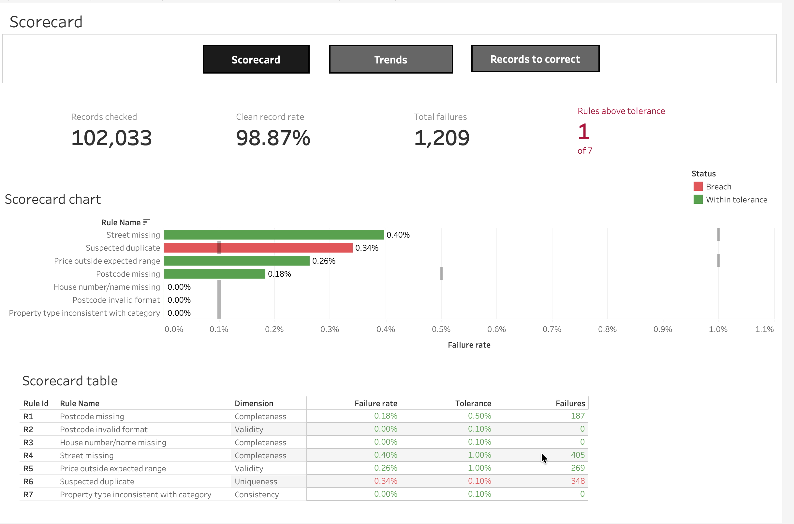
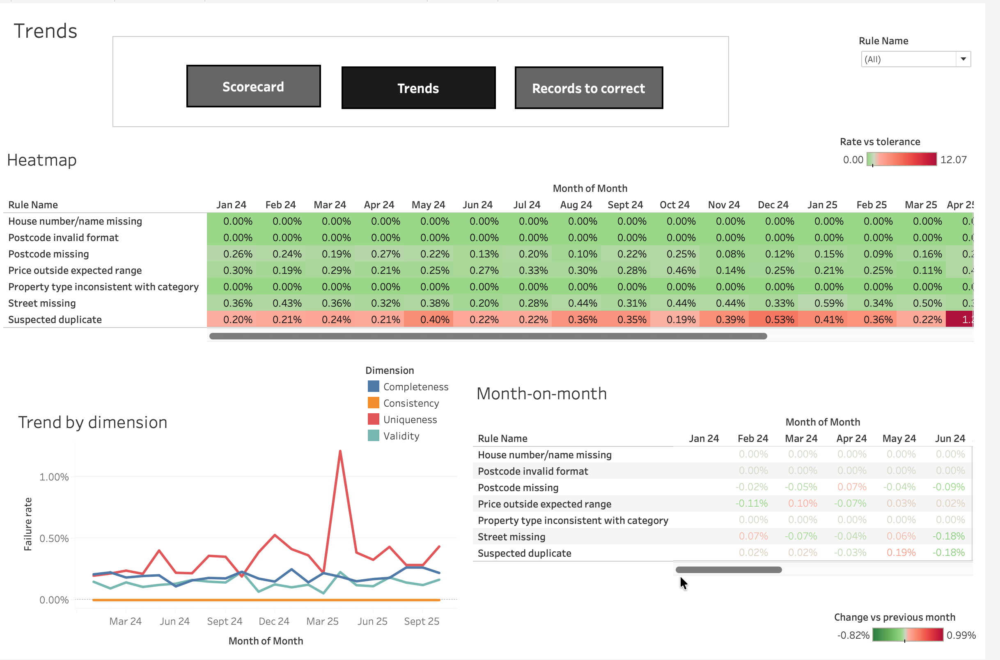
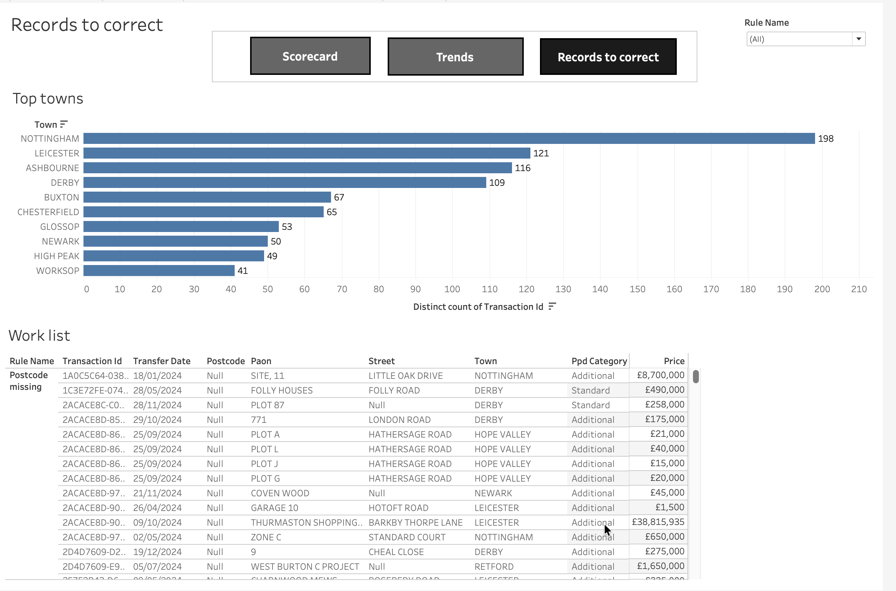

# UK Property Sales: Data Quality Monitor

A data-quality monitor for HM Land Registry Price Paid Data in the East Midlands (Nottinghamshire,
Derbyshire, Leicestershire and their cities, 2024–2025). A tested Python rules engine checks every
recorded sale against seven rules covering completeness, validity, uniqueness and consistency. A
three-page Tableau dashboard tracks each rule's failure rate against its tolerance, shows trends month
by month, and drills down to the individual records that need correcting.

**Live dashboard:** [Land Registry data quality monitor on Tableau Public](https://public.tableau.com/app/profile/yash.dubey7502/viz/LandRegistrydataqualitymonitor/Scorecard)



## Results

102,033 transactions checked; 98.87% of records pass every rule; 1,209 rule failures in total.
**1 of 7 rules breaches its tolerance.**

| Rule | Dimension | Failure rate | Tolerance | Failures | Status |
| --- | --- | --- | --- | --- | --- |
| R4 Street missing | Completeness | 0.40% | 1.0% | 405 | Within |
| R6 Suspected duplicate | Uniqueness | 0.34% | 0.1% | 348 | **Breach** |
| R5 Price outside expected range | Validity | 0.26% | 1.0% | 269 | Within |
| R1 Postcode missing | Completeness | 0.18% | 0.5% | 187 | Within |
| R2 Postcode invalid format | Validity | 0.00% | 0.1% | 0 | Within |
| R3 House number/name missing | Completeness | 0.00% | 0.1% | 0 | Within |
| R7 Property type inconsistent with category | Consistency | 0.00% | 0.1% | 0 | Within |

**Findings**

- **Duplicates breach tolerance every month,** at 0.2–0.5% against a 0.1% target. The worst month is
  April 2025 at 1.21%, twelve times the tolerance. Drilling into that month, 20 of its 28 flagged records
  are in Worksop, almost all flats at one development sold on 4 April 2025 as Category B (additional
  price paid) entries: a bulk transaction that appears to have been lodged twice.
- **Missing postcodes are mostly legitimate.** Nearly all R1 failures are Category B sales of plots,
  garages and land, which often have no postcode. The next step would be to scope R1 to Category A sales
  or give Category B its own tolerance, rather than sending these records for correction.




## Dashboard

| Page | What it shows |
| --- | --- |
| Scorecard | KPI cards, failure rate by rule against a tolerance marker (red = breach), rule table |
| Trends | Rule × month heatmap coloured by rate ÷ tolerance, monthly trend by dimension, month-on-month change |
| Records to correct | Top towns by failures and the work list of individual records |

Clicking a rule on the scorecard filters the trends; clicking a rule-and-month cell on the heatmap opens
the matching records. The two Tableau data sources are linked on a `Month key` text field
(`YYYY-MM`) and on rule name.

## Data quality rules

| Rule | Dimension | Check | Tolerance |
| --- | --- | --- | --- |
| R1 | Completeness | Postcode is blank | 0.5% |
| R2 | Validity | Postcode present but not a valid UK postcode format | 0.1% |
| R3 | Completeness | House number/name (PAON) is blank | 0.1% |
| R4 | Completeness | Street is blank | 1.0% |
| R5 | Validity | Price below £10,000 or above £5,000,000 (flag for review) | 1.0% |
| R6 | Uniqueness | Same address, date and price as another sale with a different ID | 0.1% |
| R7 | Consistency | Property type "Other" recorded as a standard (Category A) sale | 0.1% |

Tolerances are illustrative targets set for this project, not Land Registry standards. R7 follows Land
Registry's own definitions: "Other" property types belong to Category B (additional price paid entries).

## How it works

```
Land Registry yearly CSVs ──► prepare_data.py ──► transactions.csv ─┐
  (no header, ~1M rows)        (filter area,       dq_failures.csv ─┼─► Power BI semantic model ──► report
                                run 7 rules)        dq_rules.csv ───┘    (relationships, DAX)
```

The rules run in Python so they are version-controlled and tested (`tests/`, one planted failure per
rule). Power BI is the reporting layer: measures, tolerances, trends and drill-down.

## 1. Prepare the data

1. Download the **2024** and **2025** yearly files from the
   [Price Paid Data downloads page](https://www.gov.uk/government/statistical-data-sets/price-paid-data-downloads)
   (yearly files, CSV). Each is 115–230 MB.
2. Run:
   ```bash
   pip install pandas
   python prepare_data.py pp-2024.csv pp-2025.csv
   ```
   It prints each rule's failure count and rate, and writes:
   - `powerbi_data/`: `transactions.csv`, `dq_failures.csv`, `dq_rules.csv` (star schema for Power BI)
   - `tableau_data/`: `dq_monthly.csv` (month × county × property type × rule, with records checked and
     failures side by side), `dq_failure_detail.csv` (the correction work list) and `dq_rules.csv`

   **Building in Tableau instead of Power BI?** Use `tableau_data/`. The monthly table stores the
   denominator with each rule, so failure rates stay correct under any filter without relationships.

Options: `--counties NOTTINGHAM DERBY` to change the area (substring match on county), `--out folder`.

## Building the same report in Power BI (optional)

The published dashboard is built in Tableau from `tableau_data/`. The steps below build an equivalent
Power BI report from `powerbi_data/`.

## 2. Open Power BI in your browser

1. Go to **app.powerbi.com** and sign in with your **University of Nottingham account**. Personal emails
   (Gmail, Outlook.com) are not accepted. The free licence works in **My workspace**; you can't share
   reports with others, but you can build everything and take screenshots.
2. In **My workspace → Workspace settings → Power BI → General → Data model settings**, make sure
   **Users can edit data models in the Power BI service** is turned on.

If the university has blocked Power BI sign-up, see *Alternatives* at the end.

## 3. Load the three tables

1. **Create → Get data** (or **New item → Semantic model**) and choose **Text/CSV**.
   - If you can upload a local file, upload each CSV.
   - If only cloud locations are offered, put the three CSVs in your university **OneDrive** and connect
     to them from there.
2. In the Power Query editor, check column types before loading:
   - `transactions`: `transfer_date` → **Date**, `price` → **Whole number**, `dq_issue_count` → **Whole number**,
     everything else **Text** (keep `postcode` and `transaction_id` as text).
   - `dq_rules`: `tolerance_pct` → **Decimal number**.
   - `dq_failures`: both columns **Text**.
3. Name the tables exactly `transactions`, `dq_failures` and `dq_rules`, then load them.

## 4. Build the model

Open the semantic model and switch to **Model view**.

**Relationships** (drag one column onto the other):

| From (one side) | To (many side) | Direction |
| --- | --- | --- |
| `transactions[transaction_id]` | `dq_failures[transaction_id]` | Single |
| `dq_rules[rule_id]` | `dq_failures[rule_id]` | Single |
| `Date[Date]` | `transactions[transfer_date]` | Single |

Single direction matters: a rule filter must narrow the failures but not the number of records checked,
so failure rates use the right denominator.

**Date table** (New table):

```dax
Date =
ADDCOLUMNS (
    CALENDAR ( MIN ( transactions[transfer_date] ), MAX ( transactions[transfer_date] ) ),
    "Year", YEAR ( [Date] ),
    "Month start", DATE ( YEAR ( [Date] ), MONTH ( [Date] ), 1 ),
    "Month", FORMAT ( [Date], "mmm yyyy" )
)
```

Create it before adding the `Date` relationship. Mark it as a date table if the option is offered, and set
`Month` to sort by `Month start`.

**Calculated columns on `dq_failures`** (for the drill-down table):

```dax
Rule = RELATED ( dq_rules[rule_name] )
Postcode = RELATED ( transactions[postcode] )
Street = RELATED ( transactions[street] )
Town = RELATED ( transactions[town] )
Price = RELATED ( transactions[price] )
Sale date = RELATED ( transactions[transfer_date] )
```

## 5. Measures

Create these on the `transactions` table (or a dedicated measures table). Format the rate measures as
percentages with 2 decimal places.

```dax
Records checked = COUNTROWS ( transactions )

Failures = COUNTROWS ( dq_failures )

Records with issues =
CALCULATE ( COUNTROWS ( transactions ), transactions[dq_issue_count] > 0 )

Clean record rate =
DIVIDE ( [Records checked] - [Records with issues], [Records checked] )

Failure rate = DIVIDE ( [Failures], [Records checked] )

Tolerance = DIVIDE ( SELECTEDVALUE ( dq_rules[tolerance_pct] ), 100 )

Status =
IF (
    HASONEVALUE ( dq_rules[rule_id] ),
    IF ( [Failure rate] > [Tolerance], "Breach", "Within tolerance" )
)

Rules breaching tolerance =
COUNTROWS ( FILTER ( VALUES ( dq_rules[rule_id] ), [Failure rate] > [Tolerance] ) )

Failure rate vs previous month =
VAR CurrentRate = [Failure rate]
VAR PreviousRate = CALCULATE ( [Failure rate], DATEADD ( 'Date'[Date], -1, MONTH ) )
RETURN IF ( NOT ISBLANK ( PreviousRate ), CurrentRate - PreviousRate )

Status colour = IF ( [Failure rate] > [Tolerance], "#B42318", "#2E7D32" )
```

`Failure rate` is per rule when sliced by rule. At dimension level (e.g. all three Completeness rules
together) it reads as *issues per record*.

## 6. Build the report

**Page 1: Overview**
- Cards: `Records checked`, `Clean record rate`, `Rules breaching tolerance`, `Failures`.
- Bar chart: `dq_rules[rule_name]` × `Failure rate`. Colour the bars with conditional formatting →
  *Field value* → `Status colour`.
- Table: `rule_id`, `rule_name`, `dimension`, `Failure rate`, `Tolerance`, `Status`.
- Slicers: `transactions[county]`, `transactions[property_type]`.

**Page 2: Trends**
- Line chart: `Date[Month start]` × `Failure rate`, legend `dq_rules[dimension]`.
- Matrix heatmap: rows `dq_rules[rule_name]`, columns `Date[Month]`, values `Failure rate`, with a
  background colour scale (conditional formatting). This shows when each issue started or stopped.
- Card or table: `Failure rate vs previous month`, to show whether each rule is improving.

**Page 3: Records to correct**
- Slicers: `dq_failures[Rule]`, `transactions[county]`.
- Bar chart: `transactions[town]` × `Records with issues` (top 10, using a Top N filter).
- Table from `dq_failures`: `transaction_id`, `Rule`, `Sale date`, `Postcode`, `Street`, `Town`, `Price`.
  This is the work list a data operations team would correct.

**Caveat to show on the report:** Land Registry says the two most recent months are incomplete because
registration lags the sale. Add a text box saying so, or a page filter excluding the last two months.

## Alternatives if the browser route is blocked

- **University PCs**: Power BI Desktop may be installed on university computers or remote desktops.
- **Windows virtual machine**: Power BI Desktop has supported Windows on ARM since the October 2025 release,
  so a free virtual machine (e.g. UTM) running Windows 11 on Apple Silicon can work. It needs plenty of memory
  and is slow on an 8 GB MacBook Air.

## Data and licence

Contains HM Land Registry data © Crown copyright and database right 2026. Licensed under the
[Open Government Licence v3.0](https://www.nationalarchives.gov.uk/doc/open-government-licence/version/3/).
